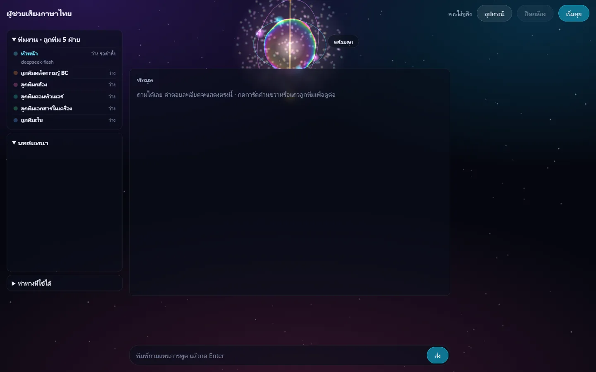
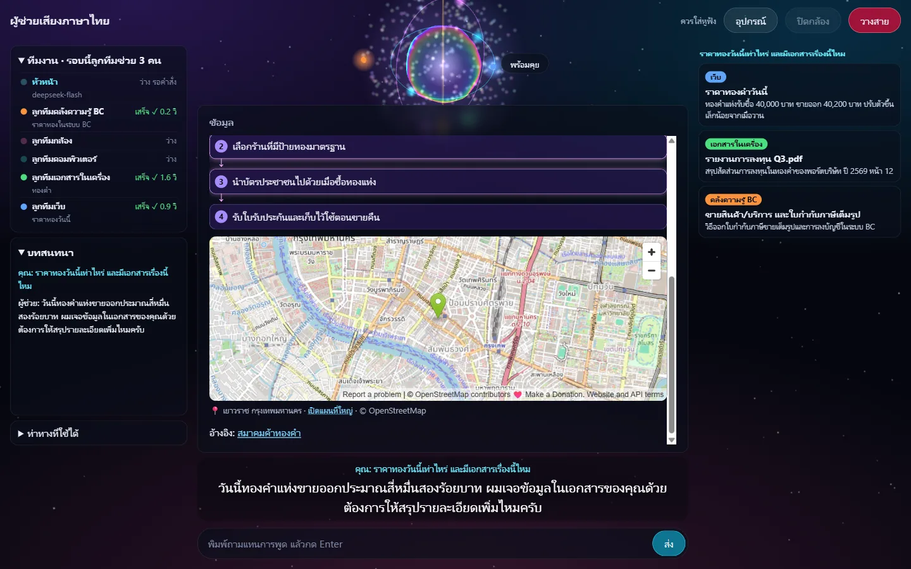
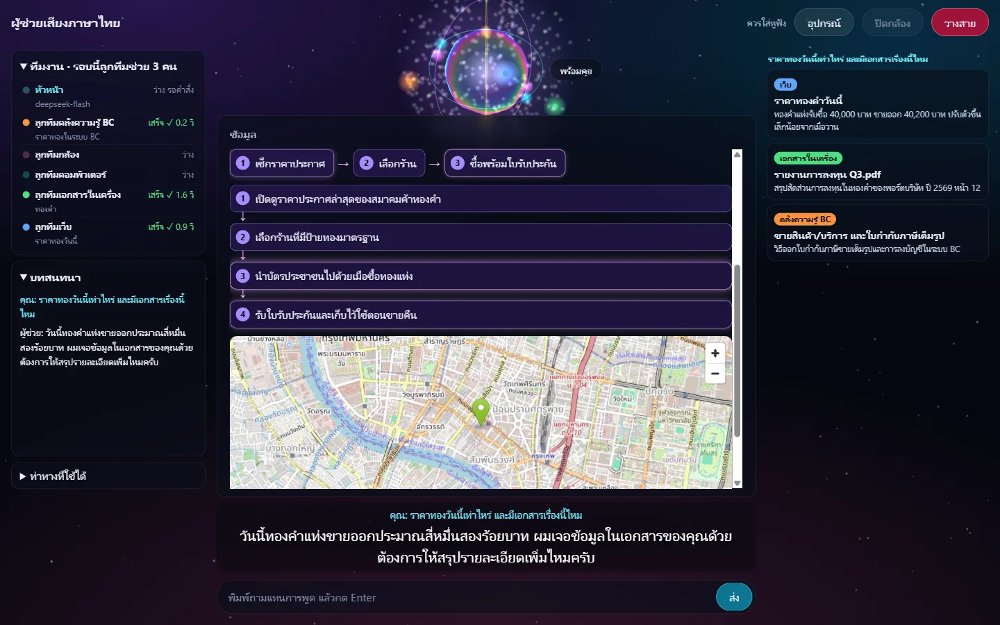
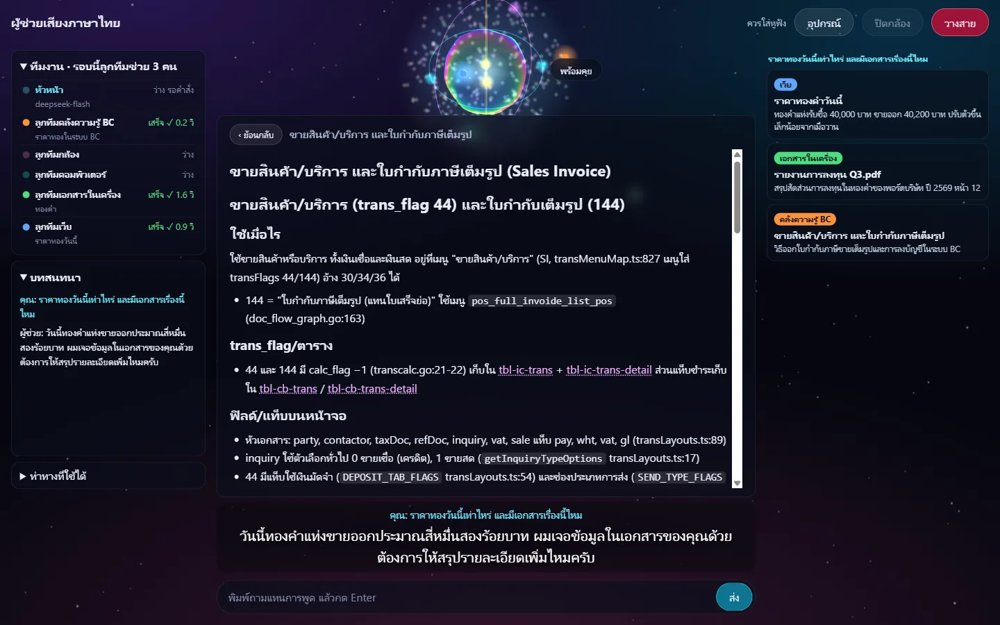
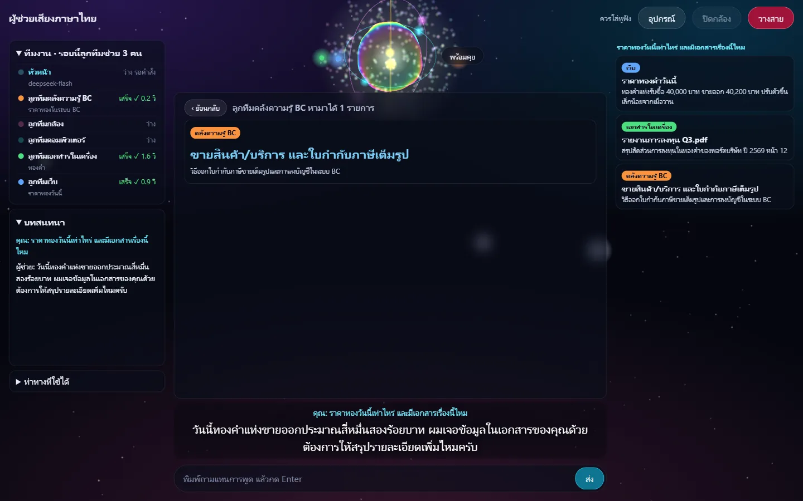
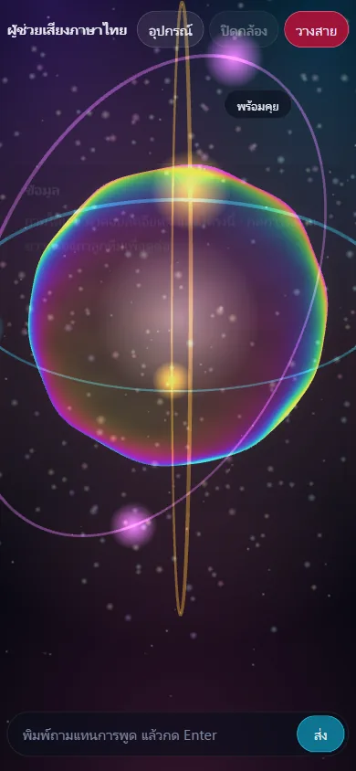
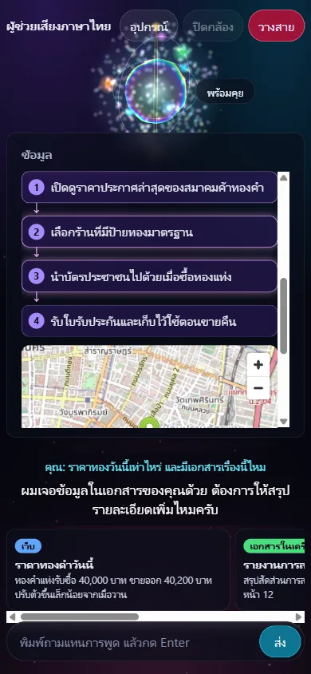

# เลขาเสียงภาษาไทยแบบคุยโทรศัพท์ (รันในเครื่อง)

เลขาผู้ชายที่รับสายแทนลุงจืด คุยด้วยเสียงได้ทันที พูดแทรกได้ ผู้โทรเป็นลุงจืดเองหรือลูกค้าที่สนใจ BC AI Account ก็ได้
ทำงานแบบหัวหน้า-ลูกทีม: หัวหน้า (DeepSeek) แจกงานให้ลูกทีมค้นพร้อมกัน
(เว็บ, เอกสารในเครื่อง, คลังความรู้ BC, Gmail, ปฏิทิน, Google Drive, คอมพิวเตอร์) แล้วสรุปให้ฟังพร้อมบอกที่มา
ห้ามเดาหรือแต่งข้อมูล พูดสรุปสั้นๆ แบบเลขา แล้วแสดงรายละเอียดเต็มบนแผงข้อมูลพร้อมวงแหวนสถานะ (SVG HUD) ซับไตเติล และแผงทีมงาน

## ภาพหน้าจอ

ภาพจากโหมดสาธิต (`?demo=1` ข้อมูลราคาทองในภาพเป็นตัวอย่าง ไม่ใช่ราคาจริง) และโน้ตจริงจากคลังความรู้ BC

| | |
|---|---|
|  |  |
| **ก่อนเริ่มคุย**: แผงทีมงาน แผงข้อมูลว่างพร้อมคำแนะนำ | **คำตอบ**: พูดสรุปสั้น แผงกลางแสดงรายละเอียดเต็ม การ์ดด้านขวาแยกตามคำถาม |
|  |  |
| **ขั้นตอนและแผนที่**: `[ขั้นตอน]` เป็นกล่องเรียงลำดับเคลื่อนไหว `[แผนที่]` ปักหมุดบน OpenStreetMap | **กดการ์ด**: เปิดโน้ตเต็มจากคลังความรู้ BC กดลิงก์ในโน้ตต่อได้ ปุ่มย้อนกลับ |
|  |   |
| **กดแถวลูกทีม**: ดูสิ่งที่ลูกทีมคนนั้นหามาได้ | **มือถือ**: แผงข้อมูลเต็มกว้าง การ์ดเลื่อนแนวนอน |

## ทำงานอย่างไร

ไมค์ → FastRTC (WebRTC + Silero VAD + จับจังหวะจบประโยค + พูดแทรก) → Faster-Whisper ภาษาไทย → หัวหน้า DeepSeek `deepseek-flash` ⇄ ลูกทีม → ตัดเป็นประโยค → OmniVoice → ลำโพง

- **หัวหน้า-ลูกทีม**:
  - หัวหน้าเรียกลูกทีมหลายตัวได้ในรอบเดียว ระบบรันพร้อมกัน (`dispatch` ใน `voice_agent.py`) แล้วหัวหน้าสรุปจากผลจริง
  - ลูกทีมคุมคอมพิวเตอร์ใช้ DeepSeek เหมือนหัวหน้า
  - แผง "ทีมงาน" บนจอแสดงสถานะหัวหน้า และลูกทีมแต่ละตัวว่ากำลังทำอะไร เสร็จแล้วหรือไม่ได้ข้อมูล ใช้เวลากี่วินาที
- **หัวหน้า DeepSeek** (`llm_tokens` ใน `voice_agent.py`):
  - ต้องมี `DEEPSEEK_API_KEY` (ไม่มีโปรแกรมไม่เริ่ม) ส่งแบบ stream พร้อมเครื่องมือ ปิดโหมดคิด (`thinking`) เพื่อให้คำแรกมาเร็ว (~0.8 วินาที)
  - ถ้า DeepSeek ล้มก่อนพูดคำแรก (เน็ตหลุด, โควตาหมด, คีย์ผิด) เลขาพูดว่า "ขอโทษครับ ตอนนี้ระบบตอบไม่ได้ชั่วคราว รบกวนถามใหม่อีกครั้งนะครับ" ไม่เดาคำตอบ ถ้าล้มหลังพูดไปแล้ว จบคำตอบตรงนั้น
  - DeepSeek V4 บางครั้งเขียนการเรียกเครื่องมือเป็นข้อความ `<｜DSML｜...>` แทน `tool_calls` (`deepseek_tokens`): ข้อความนั้นไม่ถูกพูดออกเสียง และถูกแปลงกลับเป็นการเรียกเครื่องมือจริง log เขียน `DeepSeek wrote its tool call as text`
  - ส่วนที่ยังรันในเครื่อง: ฟังเสียง (Whisper), สร้างเสียง (OmniVoice) และตัวตรวจความหมาย (`qwen3-vl` ใน Ollama)
- **Session คุยต่อเนื่อง**:
  - เบราว์เซอร์สุ่มรหัส session เก็บใน `localStorage` แล้วส่งมากับทุกสาย (`webrtc_id` = `<session>_<สาย>`)
  - ประวัติ `HISTORY_TURNS` รอบล่าสุดของแต่ละ session เก็บที่ `sessions/<session>.json` โทรกลับจากเบราว์เซอร์เดิม เลขาจำเรื่องที่คุยไว้ได้
  - รหัส session ที่ไม่ใช่เลขฐานสิบหก 8–32 ตัว ไม่ถูกใช้เป็นชื่อไฟล์ (คุยได้แต่ไม่จำ)
- **บทเลขาขายของ** (`SYSTEM_PROMPT` ใน `config.py`):
  - เป็นผู้เชี่ยวชาญตอบคำถามแบบ call center เรื่องโปรแกรมบัญชีและระบบบัญชี SME ไทย (`EXPERT` ใช้ร่วมกับ `SEARCH_ASK` และ `GENERAL_ASK` ทุกตัวที่ถาม DeepSeek) คุยต่อเนื่องในเรื่องเดียวกันจนกว่าผู้โทรจะเปลี่ยนเรื่อง
  - ยังไม่รู้ว่าใครโทร ถามชื่อก่อน ห้ามเดา
  - ไม่แน่ใจว่าผู้โทรต้องการอะไร (คำที่ได้ยินแปลก กำกวม หรือทำได้หลายแบบ) ถามกลับข้อเดียวก่อน โดยเสนอทางเลือกที่ค้นเจอ คำถามที่ชัดแล้วตอบเลย
  - เรื่องเทคนิคที่ผู้โทรขอเอง (query SQL ชื่อตาราง คอลัมน์ API) อ่านโน้ตตารางแล้วเขียนบนจอ SQL อยู่ในกรอบ ```sql ใช้ชื่อตาราง คอลัมน์ และเงื่อนไขจากผลค้นเท่านั้น ปากพูดสั้นๆ ว่าเขียนอะไรไว้ ไม่โยนให้ติดต่อกลับ
  - กับลูกค้า: คุยเหมือนเพื่อนที่รู้เรื่องบัญชี วางแผนการคุยเป็นขั้น (รู้จักกัน → ทำธุรกิจอะไร → ทำบัญชีอย่างไร ติดตรงไหน) จบด้วยคำถามข้อเดียวที่ต่อจากเรื่องที่ลูกค้าเพิ่งพูด ไม่ถามซ้ำสิ่งที่ลูกค้าบอกแล้ว
    - เดาใจได้เป็นคำถามเท่านั้น เช่น "อยากให้สต็อกตรงกับของจริงโดยไม่ต้องนับเองใช่ไหมครับ" ลูกค้าตอบรับแล้วจึงเล่าเฉพาะจุดเด่นที่ตรงกัน จากคลังความรู้ BC เท่านั้น
    - ลูกค้าชวนคุยเรื่องอื่น (ฝนตก รถติด) คุยตามสั้นๆ ด้วยการรับฟังหรือถามถึงเขา ไม่เล่าข้อเท็จจริงเอง แล้วชวนกลับเรื่องงาน
  - ราคา แพ็กเกจ โปรโมชัน ส่วนลด ที่ไม่มีในผลค้น ไม่พูดเองหรือรับปาก บอกว่าจะให้ลุงจืดติดต่อกลับ
  - ลูกค้าสนใจซื้อ ขอชื่อ ชื่อร้าน และเบอร์ทีละอย่าง แล้วอ่านทวน
  - ไม่เล่าหรือทำงานส่วนตัวของลุงจืด (อีเมล ปฏิทิน เอกสาร คอมพิวเตอร์) ให้ลูกค้า
- **ลูกทีม (เครื่องมือของหัวหน้า)**:
  - `web_search` ค้น DuckDuckGo ภาษาไทยแล้วอ่านหน้าแรก
  - `search_docs` ค้นไฟล์ `.txt .md .csv .pdf` ในโฟลเดอร์ `docs/`
  - `calc` เครื่องคิดเลขในโค้ด รับบรรทัดละสูตร `สิ่งที่คิด: สูตร` ใช้ได้แค่ตัวเลข `+ - * /` และวงเล็บ
    - คิดด้วย `Decimal` ไม่ใช้ float ปัดผลเป็นทศนิยม 2 ตำแหน่งแบบครึ่งขึ้น (0.005 → 0.01) ครั้งเดียวต่อบรรทัด
    - คำพูดที่มี "ตัวอย่าง" "สมมติ" หรือ "ตารางคำนวณ" (`EXAMPLE_ASK`) และทุกคำถามที่ลูกทีมอ่านโน้ตบีซีมาให้ บังคับให้หัวหน้าเรียก `calc` ก่อนในรอบแรก (`tool_choice`) คำแรกจึงช้าขึ้นหนึ่งรอบของหัวหน้า รหัสสมมติ เช่น `LOT A001` ใส่ในชื่อบรรทัด ตัวตรวจตัวเลขจึงไม่ตัด
    - ใช้ทำตัวอย่างที่ผู้โทรขอ เช่น `รับเข้า 10 ชิ้น ชิ้นละ 50 บาท: 10*50` ได้ `รับเข้า 10 ชิ้น ชิ้นละ 50 บาท 10*50 = 500`
      เลขาตั้งตัวเลขสมมติตามสูตรในคลังความรู้ แล้วบอกผู้โทรว่าเป็นตัวเลขสมมติ
  - `general_knowledge` ถาม DeepSeek จากความรู้ทั่วไป ใช้เมื่อคลังความรู้และเว็บไม่มีคำตอบ
    - ห้ามใช้กับเรื่องโปรแกรม BC ราคา หรือข้อมูลบริษัท เลขาต้องบอกผู้โทรว่าเป็นความรู้ทั่วไป ไม่ใช่ข้อมูลในคลังบีซี
  - เครื่องมือแบบอ่านอย่างเดียวของ MCP `bcbrain` (เช่น `search_brain`, `read_note`, `ask_brain`)
  - `gmail_search` `gmail_read` `calendar_events` `drive_search` `drive_read` อ่านอย่างเดียว (`google_tools.py`) ใช้ได้หลังรัน `google_login.py`
  - `desktop_task` ลูกทีมคุมคอมพิวเตอร์ (`desktop_agent.py` ผ่าน agent-desktop)
- **ค้นก่อนตอบ ห้ามแต่ง**:
  - คำถามที่เปลี่ยนทุกวัน (ข่าว, ราคาทอง, น้ำมัน, หุ้น, อากาศ, หวย ฯลฯ) ระบบค้นเว็บก่อนเสมอ
  - คำถามอื่นระบบค้นคลังความรู้ BC ก่อน (คะแนน `BRAIN_MIN_SCORE` ขึ้นไป) ถ้าไม่พบจะบอก LLM ตรงๆ ว่าไม่พบ
    - ก่อนค้น หัวหน้าจัดคำค้นจากคำพูดและบทสนทนาก่อน (`search_words`) เช่น "แล้วต้นทุนแบบไฟโฟล่ะ" เป็น "ต้นทุนแบบ FIFO"
      - แก้คำที่ระบบฟังเสียงเขียนผิด และใส่ทั้งคำไทยและคำอังกฤษของศัพท์ที่พูดทับศัพท์ (เช่น "หลอด" หรือ "รถ" ในเรื่องสต็อก → LOT)
      - **ถามก่อนเปลี่ยนเรื่อง**: ถ้าคำพูดล่าสุดไปเรื่องอื่นที่ไม่ใช่ที่คุยอยู่ (ระบบอื่นของโปรแกรมเดียวกันก็นับ) และผู้โทรไม่ได้บอกเองว่าจะเปลี่ยน ตัวจัดคำค้นตอบบรรทัดที่สอง `เปลี่ยนเรื่อง: เรื่องเดิม | เรื่องใหม่` แล้วรอบนั้นไม่ค้น ไม่ถามหัวหน้า เลขาพูดประโยคตายตัว "ขอถามให้ชัดก่อนครับ จะเปลี่ยนไปคุยเรื่อง… หรือยังคุยเรื่อง…ต่อครับ" (log `BOT  (topic ask)`) รอบถัดไปบอกหัวหน้าว่า "เรื่องเดิม" คือเรื่องไหน และไม่ถามซ้ำสองรอบติด (คำถามแรกของสายไม่ถาม เพราะยังไม่มีเรื่องเดิม)
      - หัวหน้าเห็นคำที่แก้แล้วด้วย ("คำพูดนี้น่าจะหมายถึง…") ไม่ใช่แค่คำที่ได้ยิน
    - รอบสุดท้าย (ไม่มีเครื่องมือให้เรียก) หัวหน้าได้หมายเหตุ "ค้นครบแล้ว ตอบจากผลที่มี" (`LAST_ROUND`) เฉพาะรอบนั้น ไม่เก็บลงประวัติ
    - รอบสุดท้ายหัวหน้าเห็นเทิร์นนี้เป็นข้อความล้วน (`plain_turn`): ตัดการเรียกเครื่องมือออก ผลค้นต่อท้ายคำถาม เพราะถ้ายังเห็นการเรียก DeepSeek มักพิมพ์การเรียกครั้งใหม่เป็นข้อความ DSML ซึ่งรอบสุดท้ายไม่มีอะไรให้รัน คำตอบจึงจบที่ "ยังหาข้อมูลที่แน่ใจไม่เจอ" (ทดสอบซ้ำ: ก่อนแก้เกิด 2-3 ใน 10 ครั้ง หลังแก้ 0 ใน 20 ครั้ง)
      - คำถามสั้นที่ต่อจากเรื่องก่อน ("แล้วยกเลิกล่ะ") เติมเรื่องให้ครบ ส่วนคำถามเรื่องใหม่ใช้เรื่องใหม่อย่างเดียว
      - ช้าขึ้นราว 0.5-1 วินาทีก่อนคำแรก ถ้าเรียกหัวหน้าไม่ได้ ระบบค้นด้วยคำที่ได้ยินตรงๆ
    - ถ้าผลค้นไม่ตรง หัวหน้าค้นเองอีกรอบด้วยคำอื่นก่อน ยังไม่เจอและเป็นความรู้ทั่วไปจึงถาม `general_knowledge`
      ถ้าเป็นเรื่อง BC จึงบอกว่ายังไม่มีข้อมูล แล้วถามว่าหมายถึงเรื่องไหน
    - ถ้าเจอ ลูกทีมบีซีเปิดโน้ตอันดับ 1 ต่อทันที แล้วส่งเฉพาะหัวข้อ `##` ที่มีคำในคำถาม (เช่น ถาม "ยกเลิกยังไง" ได้หัวข้อ "ยกเลิก/แก้ไข")
  - กฎเหล็กในคำสั่งระบบ (`config.py`): ห้ามเดา ห้ามแต่งเพิ่ม ใช้ข้อมูลจริงเท่านั้น ถ้าไม่รู้ให้ตอบว่าไม่รู้ บอกที่มา หน่วยตามแหล่ง ห้ามเดาเจตนาของผู้ใช้
  - โค้ดตรวจตัวเลขซ้ำ (`grounding.py`): ตัวเลขทุกตัวในคำพูดและบนจอ (เลขอารบิก เลขไทย หรือคำอ่าน) ต้องมีอยู่ในคำถาม ผลจากลูกทีม หรือบทสนทนาก่อนหน้า
    - ประโยคที่มีเลขอื่นถูกตัดทิ้งเงียบๆ คำตอบจบที่ประโยคที่ผ่าน ถ้าถูกตัดหมดทั้งคำตอบ พูดว่า "เรื่องนี้ผมยังหาข้อมูลที่แน่ใจไม่เจอครับ ช่วยเล่าเพิ่มอีกนิดได้ไหมครับ"
    - เบอร์โทรที่อ่านทีละตัว ("ศูนย์แปดหนึ่ง หนึ่งสองสาม สี่ห้าหกเจ็ด") นับเป็นเลขเดียวกับที่ผู้โทรบอก และไม่ถูกตัดแบ่งกลางเบอร์
    - รหัสที่อักษรอังกฤษติดตัวเลข (LOT `A001`, `IV2026`) เป็นชื่อ ไม่ใช่ตัวเลข โค้ดไม่ตรวจ ให้ตัวตรวจความหมายอ่านแทน ตัวอย่างสมมติจึงไม่ถูกตัดทั้งตาราง ส่วนเลขที่เว้นวรรค ("LOT 001") และอัตรา ("VAT7%") ยังตรวจตามปกติ ข้อจำกัด: ยอดเงินที่เขียนติดอักษร เช่น `USD100` ก็ไม่ถูกโค้ดตรวจเช่นกัน
    - ยอดเงินที่อ่านเป็นคำ ("สิบเอ็ดบาทหกสิบเจ็ดสตางค์", "สิบเอ็ดจุดหกเจ็ด") นับเป็น 11.67 เลขเดียวกับผลจาก `calc` ไม่แยกเป็น 11 กับ 67
    - เลขหลัง "จุด" ที่อ่านเป็นคำ โค้ดอ่านเอง (`point_words`) เพราะ pythainlp อ่านผิด: "เมนูสองจุดยี่สิบสอง" = 2.22, "สามจุดสิบห้า" = 3.15, "หนึ่งจุดห้าล้าน" = 1,500,000 ข้อจำกัด: รูปอื่น ("สองจุดห้าแสนสองหมื่น") ยังอ่านตาม pythainlp
    - บรรทัดบนจอที่มีเลขอื่นถูกตัดออก พร้อมหมายเหตุว่าตัดไปแล้ว
    - อัตรา (%, เปอร์เซ็นต์, ร้อยละ) ต้องเป็นอัตราในแหล่งด้วย เลขเดียวกันที่เป็นจำนวนแถวหรือเลขบรรทัดไม่นับ
  - ตัวตรวจความหมาย (`judge` ใน `voice_agent.py`) ตรวจทุกช่วงคำพูดและทุกบรรทัดบนจอ:
    - โค้ดหาคำที่ไม่มีในแหล่งก่อน (`grounding.new_words`) ช่วงที่ทุกคำมีในแหล่งผ่านทันที ไม่ต้องเรียกโมเดล
    - ช่วงที่มีคำใหม่ส่งให้ `JUDGE_MODEL` (`qwen3-vl` บน GPU) จัดประเภททีละคำ: คำพูดทั่วไป, คำอ่านหรือคำพ้องของคำในแหล่ง (ต้องบอกคำในแหล่ง แล้วโค้ดเช็กว่ามีจริง), หรือข้อมูลใหม่
    - มีข้อมูลใหม่ หรือตัวตรวจตอบไม่ได้ ถือว่าไม่มีในแหล่ง: ประโยคนั้นถูกตัดทิ้งเงียบๆ (เหมือนตัวตรวจตัวเลข) บรรทัดบนจอถูกตัดพร้อมหมายเหตุ
    - ตัวตรวจอ่านแหล่งได้แค่ `JUDGE_MAX_CHARS` ตัวอักษรท้ายสุด ถ้าจะตัดช่วงไหนและแหล่งยาวกว่านั้น จะตรวจอีกรอบด้วยบรรทัดของแหล่งที่มีคำตรงกับช่วงนั้นมากที่สุด (`grounding.near_sources`) เพราะโน้ตที่ถูกต้องมักอยู่ก่อนส่วนท้าย ช่วงที่ผ่านตั้งแต่รอบแรกไม่เสียเวลาเพิ่ม ข้อจำกัด: เลือกบรรทัดจากคำที่ตรงกันเท่านั้น บรรทัดที่ใช้คำอื่นในความหมายเดียวกันจะไม่ถูกเลือก
    - ประโยคที่บอกแค่ว่าในคลังไม่มีสิ่งนั้น ("ในคลังไม่มีตัวเลขจำนวนลูกค้าครับ") นับเป็นคำพูดทั่วไป ไม่ถูกตัด เพราะเป็นคำตอบตรงๆ ว่าไม่รู้ ส่วนประโยคที่บอกเพิ่มว่าระบบทำอะไรได้ยังต้องมีในแหล่ง
    - แถวแรกของตารางบนจอ (ชื่อคอลัมน์) ไม่ต้องผ่านตัวตรวจความหมาย ตรวจแค่ตัวเลข ถ้าหัวตารางหายด้วยเหตุอื่น หน้าเว็บยังวาดแถวที่เหลือเป็นตาราง
    - บรรทัดในกรอบโค้ด (```) ตรวจด้วยโค้ดแทนตัวตรวจความหมาย (`code_unsourced`): ทุกชื่อต้องมีในแหล่ง ยกเว้นคำ SQL (`CODE_WORDS`) ชื่อย่อ 1-2 ตัวอักษร และชื่อหลัง `AS` ตัวเลขต้องมีในแหล่ง ช่วงในแหล่ง เช่น "54-73" นับเลขที่อยู่ระหว่างด้วย หน้าเว็บวาดกรอบโค้ดคงบรรทัดและช่องว่าง
    - ตัวอักษรจีนและญี่ปุ่นที่ DeepSeek เผลอใส่ในประโยคไทย ถูกลบก่อนพูด (`JUNK`)
    - แหล่งที่ใช้ตรวจคือคำถาม ผลค้น ผลจากลูกทีม บทสนทนาก่อนหน้า สถานะระบบที่หัวหน้าได้รับ (เช่น ยังไม่ได้เชื่อม Gmail) และคำพูดของเลขาที่ใช้ได้เสมอ (`SAY_WORDS` เช่น ติดต่อกลับ, ราคา, แพ็กเกจ, รับทราบ)
  - ส่งวันที่และเวลาในเครื่องให้ LLM เฉพาะเมื่อถูกถามเรื่องวันเวลา (กันไม่ให้เอาเวลานาฬิกาไปอ้างเป็นเวลาอัปเดตของข้อมูล)
  - หัวหน้าได้รับรายชื่อลูกทีมที่มีจริงตอนนั้น จึงไม่อ้างลูกทีมที่ยังไม่ได้เชื่อม
- **ลูกทีมคุมคอมพิวเตอร์**:
  - ดูรายชื่อโปรแกรมที่เปิด อ่านข้อความและปุ่มในหน้าต่าง เปิดโปรแกรม กดปุ่ม ไม่มีเครื่องมือพิมพ์ข้อความ
  - เปิดเองได้เฉพาะโปรแกรมใน `DESKTOP_SAFE_APPS` โปรแกรมอื่นต้องรอยืนยัน
  - ปุ่มเสี่ยง (ส่ง, ลบ, บันทึก, ชำระ, ติดตั้ง, ตกลง ฯลฯ) หรือปุ่มไม่มีชื่อ ต้องรอยืนยัน
  - ยืนยันโดยพูดว่า "ยืนยัน" ภายใน 2 นาที โค้ดเป็นคนตรวจคำยืนยัน ไม่ใช่ LLM พูดอย่างอื่นถือว่ายกเลิก
- **พูดก่อนได้เอง**:
  - ต่อสายแล้วเลขาทักก่อน: "สวัสดีครับ" อัดเสียงไว้ตอน warm-up จึงเล่นทันทีที่ต่อติด หัวหน้าพูดต่อว่าเป็นเลขาของใครและถามว่าให้ช่วยอะไร ถ้าหัวหน้าขึ้นต้นด้วย "สวัสดี" หรือ "ครับ" อีก โค้ดตัดทิ้ง
  - ถ้าเชื่อม Google แล้ว การโทรครั้งแรกของวันจะสรุปนัดวันนี้และอีเมลที่ยังไม่อ่าน
  - นัดที่จะเริ่มภายใน `REMIND_MIN` นาที เลขาเตือนเองครั้งเดียว (ตอนสายว่าง)
- **คำตอบมี 2 ส่วน**:
  - ส่วนที่พูด เป็นสรุปสั้นๆ
  - หลังบรรทัด `[จอ]` เป็นรายละเอียด Markdown (ตาราง, รายการ, แหล่งที่มา) ที่ขึ้นแผงบนจอ ไม่อ่านออกเสียง
    - บรรทัด `[ขั้นตอน] ก → ข → ค` หรือ `[ขั้นตอน]` บรรทัดเดียวตามด้วยรายการเลขข้อ (แบบที่ DeepSeek เขียนจริง): หน้าเว็บวาดเป็นกล่องมีเลขลำดับ โผล่ทีละขั้น มีแสงวิ่งตามลำดับ ขั้นยาวเรียงลงล่าง ไม่ตัดขั้นทิ้ง
    - บรรทัด `[แผนที่] ชื่อสถานที่` (ชื่อต้องมาจากแหล่ง): เซิร์ฟเวอร์หาพิกัดจาก OpenStreetMap Nominatim (`geocode` ใน `voice_agent.py`) แล้วหน้าเว็บฝังแผนที่ OpenStreetMap ปักหมุด พร้อมลิงก์เปิดแผนที่ใหญ่ หาไม่เจอจะขึ้นเป็นข้อความ "ตำแหน่ง: …"
    - ค้นหาแบบ **Auto Swarm ขนานอัตโนมัติ** (`swarm_queries` + `dispatch`): แตกคำถามหลายแง่มุมเป็นคำค้นขนานพร้อมกัน แล้วกระจายอ่านโน้ตหลายใบพร้อมกัน ลดรอบรอและตอบไวขึ้น
    - ทุกคำตอบที่อธิบายเรื่องใหม่ ต่อท้ายจอด้วยตัวอย่างพร้อมข้อมูลตัวอย่าง ("ตัวอย่างสมมติ ไม่ใช่ข้อมูลจริง", `SAMPLE_LABEL` ใน `config.py`)
      โดย AI เลือกรูปแบบตัวอย่างให้เหมาะกับบริบทอัตโนมัติ: ตารางคำนวณ (`calc`), แถบสรุป `[การ์ด] หัวข้อ: ค่า | ...`, ผังโครงสร้างย่อหน้า (`.tree`), กล่องจำลองสถานการณ์ `> ...` (`.casebox`), `[ขั้นตอน]`, หรือกรอบ ```sql
    - ตาราง: แถวเลื่อนเข้ามาทีละแถว มีแสงกวาดแถวใหม่ ตัวเลขในช่องวิ่งขึ้นจนถึงค่าที่เขียนไว้ ตารางกว้างเลื่อนด้านข้างได้
      เลขลำดับในช่องแรกที่นับต่อจากแถวบน (1, 2, … 10, 11) ไม่ถูกตรวจเป็นตัวเลขอ้างอิง
  - แผงข้อมูลอยู่กลางจอเต็มความสูง วงแหวนสถานะ (HUD, SVG) ลอยอยู่ด้านหน้า บอกแค่ว่าเลขากำลังทำงาน:
    สีบอกสถานะ (พร้อมคุย เทา-ฟ้า, ฟัง ฟ้า, คิด เหลือง, พูด ม่วง) หมุนเร็วตอนคิด วงในเต้นตามเสียง ลูกทีมที่กำลังช่วยเป็นจุดสีวิ่งรอบวง
    เปิดมาใหม่เริ่มที่มุมซ้ายล่าง (84 px) เสมอเพื่อไม่บังข้อความ ลากเพื่อย้าย ลากมุมขวาล่างเพื่อย่อขยาย (64–480 px) ดับเบิลคลิกคืนที่เดิม (ซ้ายล่าง)
  - หน้าจอปรับตามขนาดเอง: จอกว้าง 901–1279 px คอลัมน์ซ้ายและการ์ดขวาแคบลง (220/240 px) ให้แผงข้อมูลกว้างขึ้น
    ตัวหนังสือในแผงโตตามความกว้างจอ (15–19 px) จอกว้างไม่เกิน 900 px ใช้แบบมือถือ
- **การ์ดข้อมูล**: ผลจากลูกทีมขึ้นเป็นการ์ดพร้อมป้ายที่มา เช่น เว็บ, เอกสารในเครื่อง, คลังความรู้ BC, เครื่องคิดเลข, ความรู้ทั่วไป, อีเมล, ปฏิทิน, Google Drive, คอมพิวเตอร์
  - การ์ดทุกรอบเก็บไว้ (สูงสุด 50 คำถาม) จัดกลุ่มตามคำถาม คำถามล่าสุดอยู่บน เลื่อนดูย้อนหลังได้ วางสายแล้วยังอยู่
- **กดดูต่อ**:
  - กดการ์ดคลังความรู้ BC หรือลิงก์ในโน้ต: เปิดโน้ตเต็มในแผงข้อมูล (`GET /note?slug=`) แล้วกดลิงก์ต่อไปได้เรื่อยๆ ปุ่ม "‹ ย้อนกลับ" ถอยทีละชั้น
  - บรรทัดที่อยู่โค้ดของโน้ต (`slug:` `sources:`) พับไว้ใต้ "ที่มาในโค้ด" ส่วนสายลูกค้า `/note` ตัดบรรทัดเหล่านี้ทิ้ง
  - กดแถวลูกทีมในแผงทีมงาน: ดูการ์ดที่ลูกทีมนั้นหามาได้ กดแถวหัวหน้า: กลับไปที่คำตอบ
- **ระหว่างค้น**: แสดงสถานะและจำนวนลูกทีมบนหน้าจอเท่านั้น ไม่พูดคั่นก่อนคำตอบ
- **พิมพ์แทนพูด**: ช่องแชทด้านล่าง ตอบด้วยเสียงและจอเหมือนพูด

## ติดตั้ง (ครั้งแรก)

ต้องมี:
- Python 3.12
- ffmpeg
- Ollama 0.40 ขึ้นไป (ต้องรันอยู่ ใช้กับตัวตรวจความหมาย)
- คีย์ DeepSeek (ต้องมี หัวหน้าและลูกทีมคุมคอมพิวเตอร์ใช้ DeepSeek)
- การ์ด NVIDIA ที่มี VRAM 16 GB ขึ้นไป

```bash
uv venv --python 3.12 .venv
```

```bash
uv pip install --python .venv/Scripts/python.exe torch==2.8.0 torchaudio==2.8.0 --index-url https://download.pytorch.org/whl/cu128
```

```bash
uv pip install --python .venv/Scripts/python.exe -r requirements.txt
```

```bash
ollama pull qwen3-vl:8b-instruct
```

ใส่คีย์ DeepSeek ในไฟล์ `.env` ข้าง `config.py` (อยู่ใน `.gitignore` ห้าม commit) บรรทัดเดียว:

```
DEEPSEEK_API_KEY=ใส่คีย์ของเราที่นี่
```

ตัวแปรระบบชื่อเดียวกันใช้แทนค่าในไฟล์ได้

ลูกทีมคุมคอมพิวเตอร์ (ต้องมี Node.js) ติดตั้ง agent-desktop ไว้ในโฟลเดอร์โปรเจกต์ ถ้าไม่ติดตั้ง ระบบจะไม่มีลูกทีมนี้:

```bash
npm install
```

เชื่อม Gmail, Google Calendar, Google Drive แบบอ่านอย่างเดียว (ทำครั้งเดียว ไม่ทำก็ใช้ส่วนอื่นได้):
1. สร้าง OAuth client ชนิด Desktop app ใน Google Cloud แล้วบันทึกเป็น `client_secret.json` ในโฟลเดอร์นี้ (รัน `google_login.py` ครั้งแรกจะแสดงขั้นตอนละเอียด)
2. รันคำสั่งด้านล่าง แล้วกดอนุญาตในเบราว์เซอร์ด้วยบัญชีของตัวเอง
3. token เก็บที่ `.secrets/google_token.json` (อยู่ใน `.gitignore`) ลบไฟล์นี้เมื่อต้องการตัดการเชื่อม

```bash
.venv/Scripts/python.exe google_login.py
```

```bash
.venv/Scripts/python.exe generate_ref.py
```

การรันครั้งแรกจะดาวน์โหลดจาก Hugging Face:
- Whisper ภาษาไทย `devkubnet/whisper-th-distill-ct2` (~1.5 GB)
- OmniVoice `k2-fsa/OmniVoice` (~2.4 GB) สัญญาอนุญาต CC-BY-NC ใช้ส่วนตัว ห้ามใช้เชิงพาณิชย์

## รัน

```bash
.venv/Scripts/python.exe voice_agent.py
```

### เปิดเองอัตโนมัติหลังเปิดเครื่อง

Task Scheduler ชื่อ `javis voice agent` จะรัน `start_hidden.vbs` ตอน logon (หน่วง 30 วินาที) ซึ่งเปิด `voice_agent.py` แบบไม่มีหน้าต่าง และเขียน log ต่อท้ายไฟล์ `voice_agent.log` (เมื่อไฟล์ใหญ่เกิน 10 MB จะสลับเก็บเป็น `voice_agent.old.log` อัตโนมัติตอนเริ่มรอบใหม่)
- ถ้าโปรแกรมหยุด (เช่น ตอน logon Ollama หรือเน็ตยังไม่พร้อม) จะเปิดใหม่หลัง 30 วินาที ได้สูงสุด 5 รอบต่อการ logon หนึ่งครั้ง
- task ไม่มีเวลาจำกัด (ค่าเริ่มต้นของ Windows จะหยุด task เองเมื่อครบ 3 วัน)
- ตั้งใหม่ด้วย PowerShell:

```powershell
$a = New-ScheduledTaskAction -Execute 'wscript.exe' -Argument '"D:\bctest01\start_hidden.vbs"' -WorkingDirectory 'D:\bctest01'
$t = New-ScheduledTaskTrigger -AtLogOn -User $env:USERNAME; $t.Delay = 'PT30S'
$s = New-ScheduledTaskSettingsSet -ExecutionTimeLimit ([TimeSpan]::Zero) -AllowStartIfOnBatteries -DontStopIfGoingOnBatteries -MultipleInstances IgnoreNew
$p = New-ScheduledTaskPrincipal -UserId $env:USERNAME -LogonType Interactive -RunLevel Limited
Register-ScheduledTask -TaskName 'javis voice agent' -Action $a -Trigger $t -Settings $s -Principal $p -Force
```

- ปิด (ต้องปิดก่อนรัน `test_call.py` หรือรันผ่านแอป Claude ไม่งั้นพอร์ตชนกัน) `Stop-ScheduledTask` ปิดแค่ตัววนเปิดใหม่ ต้องปิด python ตามด้วย:

```powershell
Stop-ScheduledTask -TaskName 'javis voice agent'
Get-CimInstance Win32_Process -Filter "Name='python.exe' AND CommandLine LIKE '%voice_agent.py%'" | ForEach-Object { Stop-Process -Id $_.ProcessId -Force }
Get-CimInstance Win32_Process -Filter "Name='ssh.exe' AND CommandLine LIKE '%:7861 %'" | ForEach-Object { Stop-Process -Id $_.ProcessId -Force }
```

  บรรทัดที่ 3 ปิด tunnel ของสายลูกค้าที่ค้างอยู่ ถ้าไม่ปิด ตัวใหม่จะต่อ tunnel ไม่ได้ และ log ขึ้น "public tunnel closed, redialling" ทุก 10 วินาที (หน้าเว็บยังใช้ได้ เพราะ tunnel ตัวเก่ายังส่งต่อให้)

- เปิดใหม่โดยไม่ต้อง logon: `Start-ScheduledTask -TaskName 'javis voice agent'`
- เลิกเปิดอัตโนมัติ: `Unregister-ScheduledTask -TaskName 'javis voice agent' -Confirm:$false`

เปิด http://127.0.0.1:7860 แล้วอนุญาตไมค์ สายเริ่มเองทันทีไม่ต้องกดปุ่ม Chrome ไม่ให้เว็บเปิดเสียงก่อนผู้ใช้แตะหน้าเว็บ ([กติกา autoplay](https://developer.chrome.com/blog/autoplay)) ถ้าขึ้นว่า "แตะตรงไหนก็ได้เพื่อเปิดเสียง" ให้แตะหน้าเว็บหนึ่งครั้ง
- **ปุ่ม "ปิดไมค์"**: ระหว่างสาย กดแล้วเบราว์เซอร์ส่งเสียงเงียบแทนเสียงไมค์ สายไม่หลุด ผู้ช่วยยังพูดได้แต่ไม่ได้ยินเรา ปุ่มเปลี่ยนเป็น "เปิดไมค์" สีส้ม กดอีกครั้งเพื่อเปิด เปลี่ยนไมค์ในเมนูอุปกรณ์ตอนปิดอยู่ก็ยังปิดอยู่ วางสายแล้วสายถัดไปเริ่มแบบเปิดไมค์
- **ตัวอย่างการใช้งาน**:
  - "ช่วยดูในเอกสารหน่อย ร้านเปิดกี่โมง" ระบบค้น `docs/`
  - "ราคาทองวันนี้เท่าไหร่" ระบบค้นเว็บ
  - "ใน BC Ai Account บันทึกใบกำกับภาษีซื้อที่เมนูไหน" ระบบค้นคลังความรู้ BC
  - "วันนี้มีนัดอะไรบ้าง มีอีเมลด่วนไหม" ลูกทีมปฏิทินกับอีเมลทำงานพร้อมกัน
  - "ตอนนี้เปิดโปรแกรมอะไรอยู่บ้าง" ลูกทีมคุมคอมพิวเตอร์ดูให้
  - ลูกค้า: "เปิดร้านวัสดุก่อสร้าง อยากได้โปรแกรมบัญชี" เลขาถามว่าทำบัญชีอย่างไร เล่าจุดเด่นจากคลังความรู้ BC ราคาให้ลุงจืดติดต่อกลับ แล้วขอชื่อร้านกับเบอร์
- **เริ่มเป็นผู้โทรคนใหม่**: ลบค่า `session` ใน `localStorage` ของหน้าเว็บ หรือลบไฟล์ใน `sessions/`
- **ใส่เอกสาร**: วางไฟล์ในโฟลเดอร์ `docs/` ข้างโปรแกรม ระบบสร้างโฟลเดอร์ให้ตอนเริ่ม และอ่านไฟล์ใหม่ทุกครั้งที่ค้น
- **ไม่ใส่หูฟังก็ได้**:
  - เบราว์เซอร์ตัดเสียงย้อนให้ (`echoCancellation`) แต่ตัดได้เฉพาะลำโพงค่าเริ่มต้นของเครื่อง ถ้าเลือกลำโพงอื่นในหน้าเว็บ ตัวตัดเสียงย้อนของ Chrome จะไม่ทำงาน ([w3c/mediacapture-extensions#31](https://github.com/w3c/mediacapture-extensions/issues/31))
  - เสียงที่เข้าไมค์ระหว่างบอทพูด ถ้าเป็นคำเดียวกับที่บอทกำลังพูด ระบบทิ้งไปและไม่ให้บอทขัดตัวเอง (`hears_itself` ใน `voice_agent.py`, log `echo of its own voice`)
- **มีคนอื่นพูดในห้อง**:
  - ระบบไม่แยกเสียงว่าใครพูด ทุกเสียงที่ถอดเป็นคำได้นับเป็นเทิร์น ถ้ามีทีวีหรือคนอื่นพูดใกล้ไมค์ ให้กดปุ่มปิดไมค์ในหน้าโทร
  - เสียงเปล่าคำเดียวไม่นับเป็นเทิร์น: "เอ่อ" "อ่า" "คือ" "นะครับ" ไม่นับเลย ส่วน "อืม" "อือ" "อ่ะ" ไม่นับเฉพาะตอนเลขากำลังพูดหรือกำลังคิด (หลังคำถาม "อืม" คือคำตอบ) (`just_filler` ใน `voice_agent.py`, log `a lone ..., not a turn`) ข้อจำกัด: เป็นรายการคำตายตัว "หืม" "ครับ" "ใช่" "หยุด" ยังนับเป็นเทิร์น
  - ถ้าผู้โทรหันไปคุยกับคนอื่นด้วยเสียงตัวเอง หัวหน้า DeepSeek ตอบแค่ `<เงียบ>` แล้วเลขาไม่พูดอะไร (`SILENT_MARK` ใน `config.py`, log `not said to the secretary`)
- **ดูหน้าจอโดยไม่ต่อ backend**: เปิด http://127.0.0.1:7860/?demo=1

ทดสอบอัตโนมัติโดยไม่ใช้ไมค์:
- โทรผ่าน WebRTC จริงด้วย aiortc
- รอเลขาทักก่อน
- ถามเรื่องเอกสาร แล้วถามโจทย์คิดเงิน
- พูดแทรกระหว่างบอทตอบ
- พิมพ์ถามเรื่อง BC ผ่าน `/chat` แล้วตรวจว่าลูกทีมคลังความรู้ BC ทำงาน และแผงทีมงานได้สถานะครบ
- DeepSeek ส่งการเรียกเครื่องมือเป็นข้อความ DSML (สตรีมจำลอง): ผู้โทรต้องได้ยินแค่ "เข้าใจครับ" และเครื่องมือ `read_note` ต้องถูกเรียกพร้อมค่าที่ถูก
- ใส่คีย์ DeepSeek ปลอม แล้วตรวจว่าเลขาพูดขอโทษแทนการเดา
- สร้างเสียงคำว่า "ครับ" 20 ครั้ง ต้องไม่ได้เสียงว่าง
- จับจังหวะจบประโยค: ต้องตัดภายใน 0.7 วินาทีหลังคำสุดท้าย, ถอดเสียงล่วงหน้าได้ข้อความเดียวกับถอดตอนจบ และถ้าเว้นวรรคแล้วพูดต่อต้องถอดใหม่
- จบประโยคแล้วแต่บอทยังไม่รับเทิร์น เงียบต่อ 3 วินาทีต้องไม่ถอดเสียงซ้ำ
- เสียงบอทย้อนเข้าไมค์ระหว่างบอทพูดต้องไม่นับเป็นเทิร์น แต่คำอื่นยังนับ
- หัวหน้า DeepSeek ต้องตอบ "คุณต่าย คุณต่าย คุณต่าย" ด้วย `<เงียบ>` และ `<เงียบ>` ต้องไม่ออกเสียง
- ตรวจว่า `sessions/<session>.json` ตรงกับประวัติที่คุยจริง (ใช้โฟลเดอร์ชั่วคราว ไม่ยุ่งกับ `sessions/` จริง)
- ต้องต่อเน็ต: เสียงผู้โทรสร้างด้วย edge-tts ของ Microsoft (ถ้าได้ 503 ให้รันใหม่)
- เสียงบอทบันทึกที่ `out_call.wav`
- ต้องปิด `voice_agent.py` ก่อน เพราะสคริปต์นี้โหลดโมเดลเอง:

```bash
.venv/Scripts/python.exe test_call.py
```

ตรวจลูกทีมแบบไม่ต้องโหลดโมเดล (ไม่กดปุ่มจริง ไม่เรียก Google จริง):

```bash
.venv/Scripts/python.exe desktop_agent.py
```

```bash
.venv/Scripts/python.exe google_tools.py
```

```bash
.venv/Scripts/python.exe grounding.py
```

## ปรับคำพูดจาก log สายจริง

- **เป้าหมาย**: เลขาคุยเก่งขึ้นเรื่อยๆ จากสายจริง โดยไม่เปลือง token ตอนไม่มีใครโทร
- **ทำงานอย่างไร**:
  - ทุกบรรทัดใน `voice_agent.log` มีรหัสสาย (ส่วนท้ายของ webrtc_id, `-` = ไม่ได้อยู่ในสาย) ต่อจากเวลา
  - log ยังบันทึกบรรทัดแผงที่ถูกตัด (`cut a panel line (judge|numbers …)`) เหมือนประโยคพูดที่ถูกตัด
  - `watch_calls.py` อ่าน log ทุก 1 นาที เฉพาะส่วนที่เพิ่มหลังรอบก่อน (จำตำแหน่งไว้ที่ `sessions/watch_offset`) พอมีคนคุยแล้วเงียบไป 2 นาที จะพิมพ์สรุปสั้นๆ แล้วจบ การจบของสคริปต์คือสัญญาณให้ AI มาอ่าน
  - สรุปมีเฉพาะบรรทัด USER, BOT, TOOLS, cut และ error ตัดวันที่ออก บรรทัดละไม่เกิน 220 ตัวอักษร สูงสุด 150 บรรทัด
  - AI แก้ได้เฉพาะคำพูด คือ `SYSTEM_PROMPT` ใน `config.py` และ `SAY_WORDS` / `JUDGE_ASK` ใน `voice_agent.py`
  - ก่อนรีสตาร์ท ต้องผ่าน `eval_talk.py`:
    - ตัวตรวจต้องตัดประโยคแต่งที่เคยหลุดได้ครบ 10 ประโยค และตัดคำคุยเล่นผิดได้ไม่เกิน 2 จาก 5 ประโยค
    - สายลูกค้าจำลอง 10 สาย (เริ่มด้วยคำทักจริง) ต้องไม่เงียบ ไม่เขียนคำสั่งเครื่องมือเป็นข้อความ ไม่จบด้วยการรับปากว่า "ขอผมอ่าน…" ไม่ถามชื่อเกิน 2 ครั้ง และคำถามระบบต้องมีแผงข้อมูล
    - ขอตัวอย่างต้องได้ตัวเลข ถามความรู้ทั่วไปต้องได้คำตอบจริงที่บอกว่าเป็นความรู้ทั่วไป ทุกสายห้ามปฏิเสธว่า "นอกขอบเขต"
    - สาย "ขอ query": ถ้าคลังมีโน้ตตารางให้แสดง SQL บนจอ ถ้าไม่มีให้ตอบตรงๆ และเสนอรายงานที่มีในระบบ ห้ามเงียบและห้ามโยนให้ติดต่อกลับ
    - สาย "ฝากติดต่อกลับ": ต้องบันทึกเบอร์โทรตรงตามที่ลูกค้าพูดลง `leads.jsonl`
    - สาย "เปลี่ยนเรื่อง": คำที่ฟังผิด ("รถอัตโนมัติ") ต้องถามก่อนหรือกลับมาเรื่อง LOT เรื่องใหม่จริงต้องถามก่อน ห้ามไปเรื่องรถยนต์ และสายอื่นห้ามถามเปลี่ยนเรื่องทั้งที่คุยเรื่องเดิม
- **ใช้**:

```bash
.venv/Scripts/python.exe watch_calls.py
```

```bash
.venv/Scripts/python.exe eval_talk.py
```

```bash
.venv/Scripts/python.exe test_watch_calls.py
```

  - `watch_calls.py --once`: พิมพ์ส่วนที่ค้างอยู่ทันทีแล้วจบ ใช้ครั้งแรกเพื่อเริ่มนับจากท้าย log ปัจจุบัน
  - `eval_talk.py`: ใช้เวลาประมาณ 1 นาที รันข้างเซิร์ฟเวอร์ที่เปิดอยู่ได้ (ไม่โหลดโมเดลลง GPU ใช้แค่ DeepSeek กับตัวตรวจบน Ollama) จบด้วย exit 0 = รีสตาร์ทได้
- **ต้องมี**: `DEEPSEEK_API_KEY` ใน `.env`, Ollama ที่มีโมเดลตัวตรวจ, เน็ตไปคลังความรู้ BC
- **ข้อจำกัด**:
  - หัวหน้า DeepSeek ตอบไม่เหมือนเดิมทุกครั้ง ผ่าน `eval_talk.py` รอบเดียวยังไม่ได้แปลว่าสายจริงจะไม่พลาด
  - ตัวดักคำรับปากลอยๆ (`STALL`) เป็นรายการคำ ถ้าเลขาใช้คำแบบใหม่จะหลุดจนกว่าจะเพิ่มคำนั้น
  - คำในชื่อบรรทัดของ `calc` นับเป็นแหล่งข้อมูล ตัวตรวจจึงไม่ตัดคำเหล่านั้น ผลบรรทัดก่อนต้องเขียนเป็นตัวเลขในบรรทัดถัดไปเอง (ตั้งชื่อตัวแปรไม่ได้)
  - คำตอบจาก `general_knowledge` มาจากความจำของ DeepSeek ไม่ได้ตรวจกับแหล่งจริง อัตราภาษีหรือกฎหมายอาจเก่า เลขาจึงต้องบอกให้เช็กกับแหล่งทางการ
  - log มีคำพูดลูกค้าจริง (เลขบัตร/เบอร์ยาวถูกปิดเป็น `###` แล้ว แต่ชื่อยังอยู่) ห้ามส่งออกนอกเครื่อง

## เปิดให้ลูกค้าคุยผ่านเว็บ (https://javis.bcsmethai.com)

ลูกค้าเปิดเว็บแล้วสายเริ่มทันที (ครั้งแรกเบราว์เซอร์ถามสิทธิ์ไมค์) รับได้หลายคนพร้อมกัน แต่ละคนมีประวัติแยกตามเบราว์เซอร์ของตัวเอง

- **สองสายในโปรแกรมเดียว** (`serve` ใน `voice_agent.py`):
  - **สายเจ้าของ** `127.0.0.1:7860`: ลูกทีมครบทุกตัว รับทีละ 1 สาย เปิดได้จากเครื่องนี้เท่านั้น
  - **สายลูกค้า** `127.0.0.1:7861`: ลูกทีมมีแค่คลังความรู้ BC, เครื่องคิดเลข, ความรู้ทั่วไป และรับฝากข้อความ (กำหนดในโค้ด `PUBLIC` ท้าย `load_workers`)
    - ไม่มีคอมพิวเตอร์ เอกสาร Google หรือค้นเว็บ ไม่มีการทักสรุปนัดหรืออีเมล
  - สายลูกค้ารับพร้อมกันได้ `PUBLIC_CALLS` สาย สายที่เกินจะถูกปฏิเสธ (`concurrency_limit_reached`) ทุกสายวางเองเมื่อครบ `PUBLIC_CALL_SECS` วินาที
  - ประวัติสายลูกค้าเก็บที่ `sessions/pub-<session>.json` แยกจากของลุงจืด ผู้โทรจากเว็บถือเป็นลูกค้าเสมอ แม้จะบอกว่าเป็นลุงจืด
- **ทางเข้าจากอินเทอร์เน็ต**:
  - โปรแกรมเปิด SSH reverse tunnel ไปที่ `PUBLIC_SSH` (เครื่อง DO ที่รัน Caddy) ให้พอร์ต `127.0.0.1:17861` ของเครื่องนั้นวิ่งมาที่ 7861 ของเครื่องนี้ ถ้าหลุดจะต่อใหม่เองทุก 10 วินาที
  - Caddy บนเครื่อง DO มีบล็อก `javis.bcsmethai.com { encode zstd gzip; reverse_proxy 127.0.0.1:17861 }` และออกใบรับรอง HTTPS ให้เอง
  - เสียง WebRTC วิ่งผ่าน TURN (coturn บนเครื่อง DO): หน้าเว็บขอรหัส TURN อายุ 1 ชั่วโมงจาก `/ice` (TURN REST API คือ HMAC-SHA1 ของ `TURN_SECRET`) ฝั่งเครื่องนี้ใช้ STUN ของ coturn
- **ตั้งค่า** ใส่ใน `.env` แล้วรัน `voice_agent.py` ตามปกติ:
  ```
  PUBLIC_SSH=root@<IP เครื่อง DO>
  TURN_HOST=javis.bcsmethai.com
  TURN_SECRET=<ค่าเดียวกับ static-auth-secret ใน /etc/turnserver.conf>
  ```
  - เครื่องนี้ต้อง SSH เข้าเครื่อง DO ด้วยกุญแจได้โดยไม่ต้องพิมพ์รหัส (`BatchMode=yes`)
  - ไม่ใส่ `PUBLIC_SSH` = สายลูกค้าเปิดเฉพาะในเครื่อง ทดสอบได้ที่ http://127.0.0.1:7861
- **เครื่อง DO** (ตั้งไว้แล้ว 2026-11-04):
  - coturn 4.6.1 ตั้งค่าที่ `/etc/turnserver.conf` (ไฟล์ตั้งต้นของแพ็กเกจเก็บไว้ที่ `/etc/turnserver.conf.dist`)
    - ใช้ `use-auth-secret` และห้ามส่งต่อเข้า IP ภายในหรือ IP ของตัวเอง
    - พอร์ต 3478 UDP/TCP และ relay 49160–49200 UDP
    - จำกัดรวม 40 การเชื่อมต่อ ไม่เกิน 6 ต่อผู้ใช้ (ผู้ใช้ = รหัสที่ขอจาก `/ice` หนึ่งครั้ง เพราะ `ice_servers()` สุ่มชื่อต่อท้าย `javis-` ทุกครั้ง) และไม่เกิน 256 kbps
  - ufw เปิด `3478/udp`, `3478/tcp`, `49160:49200/udp`
  - Caddyfile ก่อนแก้สำรองไว้ที่ `/etc/caddy/Caddyfile.bak-before-javis-20261104073344`
  - **ถอยกลับ**:
    1. ลบบล็อก `javis.bcsmethai.com` ใน `/etc/caddy/Caddyfile` แล้วรัน `systemctl reload caddy`
    2. `systemctl disable --now coturn`
    3. `ufw delete allow 3478/udp`, `ufw delete allow 3478/tcp`, `ufw delete allow 49160:49200/udp`
- **ตัวอย่าง**: ลูกค้าเปิด https://javis.bcsmethai.com บนมือถือ พูดว่า "เปิดร้านวัสดุก่อสร้าง สนใจโปรแกรมบัญชี" เลขาเล่าจุดเด่นจากคลังความรู้ BC ขอชื่อร้านกับเบอร์ไว้ให้ลุงจืดติดต่อกลับ ข้อมูลอยู่ใน `sessions/pub-*.json`

### ลูกค้าฝากข้อความให้ติดต่อกลับ

- **เป้าหมาย**: ลูกค้าที่ให้ชื่อและเบอร์โทรไว้ ลุงจืดต้องเห็นและโทรกลับได้ ไม่ต้องไล่อ่าน log (log ปิดเบอร์เป็น `###`)
- **ทำงานอย่างไร**:
  1. ลูกค้าขอให้ติดต่อกลับ แล้วบอกชื่อและเบอร์โทร (ร้าน/บริษัทและเรื่องที่ฝากใส่เพิ่มได้)
  2. หัวหน้าเรียกเครื่องมือ `leave_message` (มีเฉพาะสายลูกค้า)
  3. โค้ดตรวจว่าเบอร์มี 9–15 หลัก และตรงกับตัวเลขที่ลูกค้าพูดหรือพิมพ์เองในประวัติของลูกค้าคนนั้น (`HISTORY_TURNS` รอบล่าสุด) เบอร์ที่หัวหน้าแต่งเองจะไม่ถูกบันทึก
  4. บันทึก 1 บรรทัดต่อ 1 ข้อความลง `sessions/leads.jsonl` (เวลาเป็น UTC, รหัสสาย, ชื่อ, ร้าน/บริษัท, เบอร์, เรื่อง)
  5. เครื่องนี้ขึ้นกล่องข้อความ "มีลูกค้าฝากข้อความใหม่" สายละ 1 ครั้ง ในกล่องไม่มีข้อมูลลูกค้า
- **ดูข้อความ**: เปิด http://127.0.0.1:7860/leads บนเครื่องนี้ ใหม่สุดอยู่บน หน้านี้ไม่มีในสายลูกค้า (7861)
- **ตั้งค่า**: `LEADS_PATH` ใน `config.py`
- **ต้องมี**: Windows ที่มี `msg.exe` (รุ่น Pro) สำหรับกล่องข้อความ ถ้าไม่มี ข้อความยังถูกบันทึกและดูที่หน้า `/leads` ได้
- **ตัวอย่าง**: ลูกค้าพูด "อยากให้ลุงจืดติดต่อกลับ ผมชื่อสมชัย ร้านสมชัยการค้า เบอร์ 081 234 5678" → เลขาตอบว่าบันทึกข้อความแล้ว และแถวใหม่ขึ้นที่ `/leads`
- **ข้อจำกัด**:
  - ชื่อและชื่อร้านเก็บตามที่หัวหน้าเขียน ไม่ได้ตรวจกับคำพูดเหมือนเบอร์
  - เบอร์ที่พูดแยกสองช่วงโดยมีตัวเลขอื่นคั่น จะไม่ผ่านและเลขาจะถามเบอร์ใหม่
  - ฝากได้ 3 ข้อความต่อสาย หน้า `/leads` แสดง 200 รายการล่าสุด ไม่มีปุ่มลบหรือทำเครื่องหมายว่าโทรแล้ว (แก้ไฟล์เอง)
  - ไฟล์นี้เป็นข้อมูลลูกค้า อยู่ใน `sessions/` ซึ่งไม่เข้า git และห้ามส่งออกนอกเครื่อง

## เปลี่ยนเป็นเสียงของเราเอง (Voice cloning)

1. อัดเสียงพูดชัดๆ 3–8 วินาที ไม่มีเสียงรบกวน แล้วบันทึกทับไฟล์ `ref_audio.wav` (ควรเป็น 24 kHz mono)
   แปลงไฟล์ด้วย: `ffmpeg -i myvoice.m4a -ac 1 -ar 24000 ref_audio.wav`
2. แก้ `REF_TEXT` ใน `config.py` ให้ตรงกับคำที่พูดในไฟล์ **ทุกคำ** (ถ้าไม่ตรง เสียงจะเพี้ยน/พูดข้าม)
3. รัน `voice_agent.py` ใหม่ ไม่ต้องรัน `generate_ref.py` อีก (ถ้ารัน ไฟล์เสียงเราจะถูกเขียนทับ)

## ตั้งค่า (`config.py` หรือ env)

| ค่า | ค่าเริ่มต้น | หมายเหตุ |
|---|---|---|
| `DEEPSEEK_API_KEY` | (ว่าง) | ต้องใส่ใน `.env` ไม่มีโปรแกรมไม่เริ่ม |
| `DEEPSEEK_MODEL` | `deepseek-flash` | รุ่นของหัวหน้า DeepSeek (env) |
| `DEEPSEEK_TIMEOUT` | `15` | วินาทีที่รอ DeepSeek โดยไม่ได้ข้อมูล ก่อนเลิกรอแล้วพูดขอโทษ (`config.py`) |
| `HISTORY_TURNS` | `10` | จำนวนรอบถาม-ตอบที่จำต่อ session (`config.py`) |
| `SESSIONS_DIR` | `sessions/` | ที่เก็บประวัติแต่ละ session (`config.py`, อยู่ใน `.gitignore`) |
| `LLM_TEMPERATURE` | `0.2` | ความสุ่มของหัวหน้า DeepSeek ค่าต่ำ = ยึดตามแหล่ง (ที่ 0.6 โมเดลเดิมตอบราคาทองไม่ตรงกันทุกรอบ) |
| `VISION_MODEL` | `qwen3-vl:8b-instruct` | โมเดลใน Ollama ของตัวตรวจความหมาย |
| `JUDGE_MODEL` | เท่ากับ `VISION_MODEL` | ตัวตรวจความหมาย |
| `JUDGE_MAX_CHARS` | `4500` | ความยาวแหล่ง (ส่วนท้าย) ที่ส่งให้ตัวตรวจ และขนาดช่วงที่ใช้ตรวจรอบสอง `qwen3-vl` รับได้ 4K โทเค็น |
| `STT_MODEL` | `devkubnet/whisper-th-distill-ct2` | Whisper ที่จูนภาษาไทย ใช้ `large-v3-turbo` เมื่อต้องการโมเดลหลายภาษา |
| `MCP_SERVERS` | `bcbrain` | แก้ใน `config.py` ระบบเปิดให้ LLM ใช้เฉพาะเครื่องมือที่ server ประกาศว่าอ่านอย่างเดียว |
| `DOCS_DIR` | `docs/` | โฟลเดอร์เอกสารที่ `search_docs` ค้น |
| `OLLAMA_URL` | `http://127.0.0.1:11434` | ใช้ 127.0.0.1 ไม่ใช้ localhost เพราะบน Windows ทุกครั้งที่ต่อใหม่จะช้าไป ~2 วินาที |
| `VAD_MIN_SPEECH_MS` | `100` | ถ้าเสียงรอบข้างดังจนบอทไม่ยอมตอบ ให้เพิ่มค่านี้ |
| `PAUSE_SILENCE_S` | `0.5` | เงียบนานเท่านี้หลังคำสุดท้ายถือว่าพูดจบ (ค่าเริ่มต้นของ LiveKit) ถ้าบอทชอบตัดกลางประโยคให้เพิ่ม (`config.py`) |
| `EARLY_STT_SILENCE_S` | `0.25` | เงียบนานเท่านี้เริ่มถอดเสียงล่วงหน้า ถ้าพูดต่อจะทิ้งผลแล้วถอดใหม่ (`config.py`) |
| `FORCE_CPU=1` | - | บังคับใช้ CPU (Whisper int8) |
| `PORT` | `7860` | สายเจ้าของ (127.0.0.1 เท่านั้น) |
| `PUBLIC_PORT` | `7861` | สายลูกค้า (127.0.0.1 ให้ tunnel เข้ามาเท่านั้น) |
| `PUBLIC_CALLS` | `3` | จำนวนลูกค้าที่คุยพร้อมกันได้ (GPU ตัวเดียว และค่า DeepSeek) |
| `PUBLIC_CALL_SECS` | `600` | สายลูกค้าวางเองเมื่อครบกี่วินาที |
| `PUBLIC_SSH` | (ว่าง) | `user@host` ของเครื่องที่รัน Caddy ว่างไว้ = ไม่เปิด tunnel |
| `PUBLIC_TUNNEL_PORT` | `17861` | พอร์ต 127.0.0.1 บนเครื่องนั้นที่ Caddy ส่งต่อมา |
| `TURN_HOST` | (ว่าง) | โดเมนของ coturn ว่างไว้ = ไม่มี TURN (ลูกค้าหลัง NAT บางแบบจะต่อเสียงไม่ได้) |
| `TURN_SECRET` | (ว่าง) | `static-auth-secret` ของ coturn ใส่ใน `.env` เท่านั้น |
| `USER_NAME` | `ลุงจืด` | ชื่อที่เลขาใช้เรียกผู้ใช้ (`config.py`) |
| `BRAIN_MIN_SCORE` | `50` | คะแนน `search_brain` ขั้นต่ำที่นับว่าเกี่ยวข้อง (`config.py`) |
| `REMIND_MIN` | `10` | เตือนนัดก่อนเริ่มกี่นาที (`config.py`) |
| `DESKTOP_SAFE_APPS` | notepad, calc, explorer, ... | โปรแกรมที่ลูกทีมเปิดเองได้โดยไม่ต้องถาม (`config.py`) |
| `TTS_STEP` | `16` | ขั้นคำนวณเสียงของ OmniVoice: 16 ใช้ ~0.5 วินาทีต่อประโยค, 32 ใช้ ~1.2 วินาที |

## ข้อจำกัด

- **การรับสาย**:
  - สายเจ้าของรับทีละ 1 สาย สายลูกค้ารับพร้อมกันได้ `PUBLIC_CALLS` สาย
  - ประวัติแยกตามเบราว์เซอร์ ไม่ใช่ตามคน ยังไม่มีปุ่มเริ่มคุยใหม่บนหน้าเว็บ
  - เปิดหน้าเว็บแล้วสายเริ่มทันที ใครเปิดค้างไว้ก็ใช้สายลูกค้าไป 1 ใน `PUBLIC_CALLS` สายจนครบ `PUBLIC_CALL_SECS` หรือปิดหน้า
  - พูดคำเดียวกับที่บอทกำลังพูดทับบอท (เช่นบอทถาม "สนใจใบเสร็จแบบไหน" แล้วตอบ "ใบเสร็จ" ทับ) ระบบถือเป็นเสียงย้อน ต้องพูดอีกครั้งหลังบอทหยุด
  - คำย่ออังกฤษ: Whisper เขียน "POS" เป็น "พีโอเอส" ระบบเติม POS ลงคำค้นให้ (`grounding.acronyms`) และตัวตรวจถือว่า พีโอเอส = POS ข้อจำกัดคือคำที่ออกเสียงเหมือนตัวอักษรที่ติดกันมาจะถูกรวมไปด้วย เช่น "พีโอเอสดี" เป็น POSD
  - เลขารู้ว่าใครโทรจากคำบอกของผู้โทรเท่านั้น ไม่มีการยืนยันตัวตน
  - SQL ที่เขียนให้ตรวจแค่ว่าชื่อและตัวเลขมีในคลัง ไม่ได้ลองรันกับฐานข้อมูลจริง ชื่อเล่นตาราง (alias) ที่ยาวกว่า 2 ตัวและใช้ข้ามบรรทัดถูกตัด และคอลัมน์ที่ไม่ได้อ่านโน้ตตารางในรอบนั้นถูกตัด แม้จะมีจริง
  - `<เงียบ>` จับได้แน่นอนเฉพาะกรณีชัดๆ เช่น เรียกชื่อคนอื่นซ้ำๆ หรือ "ไปกินข้าวกันก่อนนะ" คำค้างอย่าง "ส่วน" บางครั้งยังได้คำตอบ และถ้าผู้โทรหันไปคุยกับคนอื่นระหว่างบอทพูด บอทจะหยุดพูดก่อนแล้วจึงเงียบ
  - ถ้าเชื่อม Google แล้ว สรุปนัดและอีเมลตอนทักสายแรกของวันจะพูดให้ใครก็ตามที่โทรเข้าสายเจ้าของ (สายลูกค้าไม่มีส่วนนี้)
- **สายลูกค้า (javis)**:
  - GPU ตัวเดียวรับทุกสาย 3 สายพร้อมกันใช้ VRAM สูงสุด 15.7–16.0 GB จาก 16.3 GB และสร้างเสียงได้ทีละวลี (`TTS_LOCK`) วลีแรกมาใน 1.9–7.3 วินาทีหลังผู้โทรพูดจบ (รวมเวลารอเงียบและ Whisper) (วัด 2026-11-04 ตอนยังมี Typhoon ในเครื่อง ยังไม่ได้วัด 3 สายใหม่) สายเดียวหลังเอา Typhoon ออกใช้ VRAM สูงสุด 15.0 GB รวมโปรแกรมอื่นบนเครื่อง
  - ผู้โทรที่เครือข่ายปิดทั้ง UDP และ TCP พอร์ต 3478 จะต่อเสียงไม่ได้ (ยังไม่มี TURN ผ่าน TLS พอร์ต 443)
  - เซิร์ฟเวอร์รอคำตอบ STUN แค่ 1 วินาทีก่อนตอบ offer (`aioice` ใน `voice_agent.py`) ถ้าเน็ตฝั่งเครื่องนี้ตอบช้ากว่านั้น ลูกค้าหลัง NAT จะต่อเสียงไม่ได้
  - ใครเปิดเว็บก็ขอรหัส TURN จาก `/ice` ได้ coturn จึงจำกัดโควตาและความเร็ว และห้ามส่งต่อเข้า IP ภายใน
  - ไม่มีการยืนยันตัวตนหรือกันสแปม นอกจากจำกัดจำนวนสายและเวลาต่อสาย ค่า DeepSeek คิดตามการใช้จริง
  - log ของเซิร์ฟเวอร์ปิดเลขยาว (เบอร์ เลขผู้เสียภาษี) เป็น `###` แต่ชื่อคนและชื่อร้านยังอยู่ใน log
  - tunnel อยู่ในโปรแกรม ถ้าปิด `voice_agent.py` หรือปิดเครื่อง เว็บจะขึ้น 502
    - หลังรีบูต โปรแกรมเริ่มเมื่อลุงจืด logon เข้า Windows แล้ว ระหว่างที่ยังไม่ logon เว็บจะขึ้น 502 (task เป็นแบบ Interactive เพราะลูกทีมคุมคอมพิวเตอร์ต้องเห็นหน้าจอ)
    - ถ้าโปรแกรมหยุดครบ 5 รอบใน logon เดียว จะไม่เปิดเองอีกจนกว่าจะ logon ใหม่หรือสั่ง `Start-ScheduledTask` ดูสาเหตุได้ใน `voice_agent.log`
  - เสียง OmniVoice ใช้สัญญาอนุญาต CC-BY-NC (ห้ามใช้เชิงพาณิชย์) ลุงจืดเลือกใช้ไปก่อน
- **ข้อมูลที่ส่งออกนอกเครื่อง**:
  - DeepSeek: คำพูดของผู้โทร ประวัติใน session ผลค้น คำตอบของลูกทีม และข้อความบนจอคอมพิวเตอร์ที่ลูกทีมคุมคอมพิวเตอร์อ่าน ถูกส่งไปที่ DeepSeek
  - บรรทัด `[แผนที่]`: ชื่อสถานที่ถูกส่งไปที่ OpenStreetMap Nominatim เพื่อหาพิกัด (ไม่เกิน 1 ครั้งต่อวินาที, ชื่อแอป `GEO_USER_AGENT` ใน `config.py`, เก็บผลที่เจอไว้ในหน่วยความจำ) และเบราว์เซอร์ของผู้โทรโหลดภาพแผนที่จาก `openstreetmap.org` เอง
  - ทุกประโยคของผู้โทรถูกส่งเป็นคำค้นไปที่คลังความรู้ BC (`brain.bcsmethai.com`) ระบบตัดเลขยาว (เบอร์โทร เลขผู้เสียภาษี) ออกก่อน แต่ชื่อคนและชื่อร้านยังไปด้วย
- **ความเร็ว**:
  - หัวหน้า DeepSeek: วลีแรกมาใน 0.7–2.6 วินาทีหลังได้ข้อความจาก Whisper (วัดจากการเล่นบทลูกค้าซ้ำ)
  - ถ้าหัวหน้าส่งงานค้นเว็บหรือเปิดเอกสาร บอทพูดคำสั้นๆ ว่ากำลังค้นก่อน (เสียงสร้างไว้ล่วงหน้าตอนเริ่มโปรแกรม)
  - วัดก่อนหน้า (DeepSeek, การรอเงียบแบบเดิม): ถอดเสียง 0.21 วินาที, หัวหน้าได้คำแรก 0.70 วินาที, ตัวตรวจเฉลี่ย 0.30 วินาที, สร้างเสียง 0.48 วินาทีต่อประโยค รวมพูดจบถึงวลีแรก 1.39–2.42 วินาที
  - วัดล่าสุดจาก `test_call.py` (2026-11-04 20:04, สายเดียว): หัวหน้าคิดประโยคแรก 0.73–1.25 วินาที, ตัวตรวจ 0 วินาทีเมื่อทุกคำมีในแหล่ง (ถ้าต้องถามโมเดล 0.77–1.62 วินาที), สร้างเสียง 0.46–0.78 วินาทีต่อประโยค, ผู้โทรพูดจบถึงวลีแรก 1.24–2.70 วินาที
  - **ดูว่าช่วงไหนช้า**: log ทุกประโยคเขียน `BOT  (รวม | boss … judge … voice …)` คือเวลารวมนับจากเริ่มเทิร์น, หัวหน้าคิดประโยคนั้น, ตัวตรวจ, สร้างเสียง ประโยคที่ถูกตัดเขียน `cut a sentence (judge …)`
  - ต่อ DeepSeek และ MCP แบบเปิดค้าง (keep-alive) ประหยัด ~0.16 วินาทีต่อครั้ง
  - **จับจังหวะจบประโยค** (`determine_pause` ใน `voice_agent.py` ไอเดียจาก LiveKit Agents):
    - ตรวจทุก 0.1 วินาทีว่าเงียบหลังคำสุดท้ายนานเท่าไร ครบ 0.5 วินาทีถือว่าพูดจบ (วัดได้ 0.50 วินาทีทุกครั้ง)
    - ของเดิมของ FastRTC ตรวจทีละช่วง 0.6 วินาที วัดได้ 0.30–0.80 วินาที (เฉลี่ย 0.55) และบางครั้งตัดตอนเงียบแค่ 0.3 วินาที
    - เริ่มถอดเสียงล่วงหน้าตั้งแต่เงียบ 0.25 วินาที (แบบ preemptive generation ของ LiveKit แต่ทำแค่ส่วนถอดเสียง เพราะเครื่องมือของหัวหน้าทำงานจริงได้) ถ้าผู้โทรพูดต่อจะทิ้งผลแล้วถอดใหม่
    - ถอดล่วงหน้าครั้งเดียวต่อช่วงพูด ถ้าจบประโยคแล้วแต่บอทยังไม่ว่างรับเทิร์น ความเงียบที่ตามมาไม่ทำให้ถอดซ้ำ งานถอดที่ล้าสมัยและยังไม่เริ่มจะถูกยกเลิก
    - รู้ว่าเริ่มพูดภายใน 0.2 วินาที (เดิม 0.2–0.7) ใช้ CPU ราว 0.6 มิลลิวินาทีต่อเฟรม 20 มิลลิวินาที
    - ตัวจับจังหวะจบประโยคแบบโมเดลของ LiveKit ยังไม่รองรับภาษาไทย จึงใช้แค่การนับความเงียบ
- **แผนที่**: ใช้ผลอันดับ 1 ของ Nominatim ชื่อสถานที่ที่กำกวมอาจปักผิดที่ ถ้า Nominatim ไม่ตอบใน 5 วินาที บรรทัดนั้นขึ้นเป็นข้อความแทน
- **การค้นเอกสาร**:
  - ค้นด้วยการจับคำ (trigram) ไม่ใช่ค้นตามความหมาย
  - ไฟล์ PDF ที่เป็นภาพสแกนจะอ่านไม่ได้
  - ไฟล์ที่ใหญ่กว่า 20 MB จะถูกข้าม
- **การค้นเว็บ**: DuckDuckGo บางครั้งไม่คืนผล หรือถูกจำกัดอัตรา ระบบจะบอกตรงๆ ว่าไม่พบ
- **การค้นก่อนตอบ**:
  - แยกคำถามด้วยคำสำคัญและคะแนนค้นคงที่ คำถามที่หลุดคำเหล่านั้นขึ้นกับว่า LLM จะเรียกลูกทีมเอง
  - LLM ยังอาจสรุปผิดจากผลค้นได้ ควรดูแหล่งที่มาบนการ์ดประกอบ
  - คำค้นที่หัวหน้าจัดให้อาจตีความคำถามผิด แล้วได้โน้ตเรื่องอื่นมา (ดูคำที่ใช้ค้นได้จากบรรทัด `TOOLS` ใน log)
  - ตัวจับเปลี่ยนเรื่องเป็นการตัดสินของ DeepSeek อาจถามทั้งที่เป็นเรื่องเดิม หรือปล่อยเรื่องใหม่ผ่านโดยไม่ถาม และ `EXAMPLE_ASK` เป็นรายการคำ "มีตัวอย่างลูกค้าไหม" ก็ถูกบังคับเรียก `calc` หนึ่งครั้ง
- **ตัวตรวจตัวเลข (`grounding.py`)**:
  - ตรวจแค่ว่าตัวเลขมีอยู่ในแหล่งหรือไม่ ไม่ได้ตรวจความหมาย ถ้าเอาเลขจริงไปติดป้าย หน่วย หรือที่มาผิด จะยังหลุดได้
  - เลขที่ LLM คิดหรือแปลงเอง (ผลรวม, ค.ศ. เป็น พ.ศ., เวลาในแหล่งที่เขียนเป็นคำแล้วแปลงเป็น 07:00) ถูกตัดด้วย
  - เลข 0–9 ตัวเดียวตรวจเฉพาะเมื่อเป็นอัตรา จำนวนเงิน หรือระยะเวลา (ตามด้วย %, เปอร์เซ็นต์, บาท, ดอลลาร์, วัน, สัปดาห์, เดือน, ปี หรือหลังคำว่าร้อยละ)
  - ตรวจทีละประโยค ประโยคที่พูดไปก่อนเจอตัวเลขแต่งจะได้ยินไปแล้ว
- **ตัวตรวจความหมาย**:
  - ประโยคที่เอาคำในแหล่งมาเรียงเป็นข้อความใหม่ผ่านได้ เพราะไม่มีคำใหม่ให้ตรวจ เช่น "ต้องยกเลิกใบกำกับภาษีขายผ่านระบบบัญชีที่ใช้อยู่"
  - คำที่เรียบเรียงใหม่หรือคำอ่านชื่อในโค้ดอาจถูกตัดทั้งที่ถูก เช่น "ยกเว้นวันพุธ" แทน "ปิดทุกวันพุธ", "ดอกแคนเซิล" แทน `doc_cancel` (ทดสอบ 26 ช่วง ถูก 22 ช่วง)
  - ช่วงที่มีคำใหม่ใช้เวลาตรวจ 0.7–3.5 วินาที ช่วงที่ไม่มีคำใหม่ไม่เสียเวลา
  - คำที่ยาว 5 ตัวอักษรขึ้นไปและสะกดต่างจากข้อความในแหล่งแค่ราว 1 ตัว ถือเป็นคำเดียวกันโดยไม่ถามตัวตรวจ (`grounding.new_words`)
    - เช่น หัวหน้าพูดว่า "ทันตกรรม" ส่วน Whisper ถอดคำของผู้โทรเป็น "ทันตะกรรม"
    - คำยาวที่ความหมายต่างแต่สะกดต่างกันแค่ตัวเดียว จึงหลุดได้
  - คำทั่วไปในรายการของ pythainlp ไม่ถูกตรวจ เช่น ปิด เปิด ไม่ มี ได้ ถ้าสลับ "เปิด" กับ "ปิด" จะหลุดได้
  - คำถามกลับที่พาเรื่องใหม่เข้ามาถูกตัด เช่น "พรุ่งนี้จะไปงานสัมมนาไหม" (คำทักอย่าง "สบายดีไหม" อยู่ในรายการคำที่พูดได้เสมอ `SAY_WORDS`)
  - คำถามถึงฝั่งลูกค้า (ร้าน สต็อก สาขา บิล ปัญหา) ผ่านได้ แต่ยังถูกตัดบ้าง เช่น "หรือช้าตอนไหนเป็นพิเศษ" (ทดสอบกับคำพูดจากสายจำลอง 19 ช่วง ผิด 2 ช่วง ทั้งสองเป็นคำถามที่ถูกตัด ประโยคแต่งทั้ง 9 ช่วงถูกตัดหมด)
  - การเดาที่พูดเป็นข้อความด้วยคำในคลังความรู้ผ่านได้ เช่น "สต็อกไม่ตรงน่าจะมาจากต้นทุนเดิมค้างอยู่" แม้คำสั่งระบบให้เดาเป็นคำถามเท่านั้น
  - หัวหน้าบางครั้งแปลศัพท์เฉพาะเป็นคำไทยเอง (เช่น "flag 45" เป็น "ธงสี่ห้า") แล้วถูกตัดทั้งที่ข้อมูลถูก แม้คำสั่งระบบสั่งให้ใช้คำเดียวกับแหล่ง
  - โน้ตบีซีส่งให้หัวหน้าเฉพาะหัวข้อที่ชื่อตรงกับคำในคำถาม ถ้าคำตอบอยู่ใต้หัวข้อชื่ออื่น หัวหน้าจะเห็นแค่ย่อของโน้ต
- **Google**:
  - อ่านอย่างเดียว ส่งอีเมล แก้นัด หรือแก้ไฟล์ไม่ได้
  - เนื้อหาอีเมลอาจมีข้อความที่พยายามสั่ง LLM (prompt injection) เช่น ชักนำคำค้นเว็บ ระบบไม่มีเครื่องมือส่งข้อมูลออก แต่ยังกันไม่ได้ 100%
  - การเตือนนัดทำงานเฉพาะตอนที่หน้าเว็บต่อสายอยู่
- **ลูกทีมคุมคอมพิวเตอร์**:
  - ใช้ Windows UI Automation โปรแกรมที่ไม่เปิดข้อมูลให้ (บางเกม, หน้าต่างแบบวาดเอง) อ่านไม่ได้
  - ตรวจปุ่มเสี่ยงด้วยรายการคำ ปุ่มที่ชื่อไม่ตรงคำเหล่านั้นจะกดได้เลย
  - ข้อความบนจอไม่ถูกบันทึกลง log แต่ถูกส่งให้ลูกทีมบน DeepSeek อ่าน (ออกนอกเครื่อง) แล้วคำตอบสรุปของลูกทีมส่งต่อให้หัวหน้า
- **การพูดแทรก**:
  - พอเริ่มพูดทับ หน้าเว็บจะหรี่เสียงเลขาเหลือ 15% ทันทีที่ VAD ของ FastRTC จับเสียงพูดได้ (ช้ากว่าเริ่มพูดจริงราว 0.2 วินาที)
  - เลขาหยุดพูดจริงเมื่อเราพูดจบหนึ่งช่วง แล้วเสียงจะกลับดังเท่าเดิมเมื่อเริ่มตอบรอบใหม่
  - ก่อนตัดเลขา ระบบเช็คด้วย VAD ของ Whisper (ตั้งค่าเดียวกับตอนถอดเสียง) ว่ามีเสียงพูดจริง
    - ถ้าไม่มี (เสียงสะท้อน เสียงเคาะ) เลขาจะพูดต่อและเสียงกลับดังเท่าเดิม
    - เสียงรบกวนที่ VAD ของ Whisper ฟังว่าเป็นคำพูด ยังตัดเลขาได้
  - `BargeInReplyOnPause` แก้บั๊กของ FastRTC ที่ทิ้งเสียงพูดแทรก
  - ประวัติสนทนาอาจมีวลีของบอทที่ถูกตัดก่อนเล่นจริงติดอยู่ด้วย
- **ตัวเลข**: ตัวสร้างเสียงอ่านตัวเลขดิบไม่แน่นอน (เช่น `1,250.50`) จึงสั่งให้ LLM เขียนตัวเลขในส่วนที่พูดเป็นคำอ่าน (ส่วน `[จอ]` ใช้ตัวเลขได้)
- **เวอร์ชัน torch**: ต้องใช้ torch/torchaudio 2.8 เพราะ torchaudio ตั้งแต่ 2.9 ต้องใช้ torchcodec ร่วมกับ FFmpeg แบบ shared DLL
